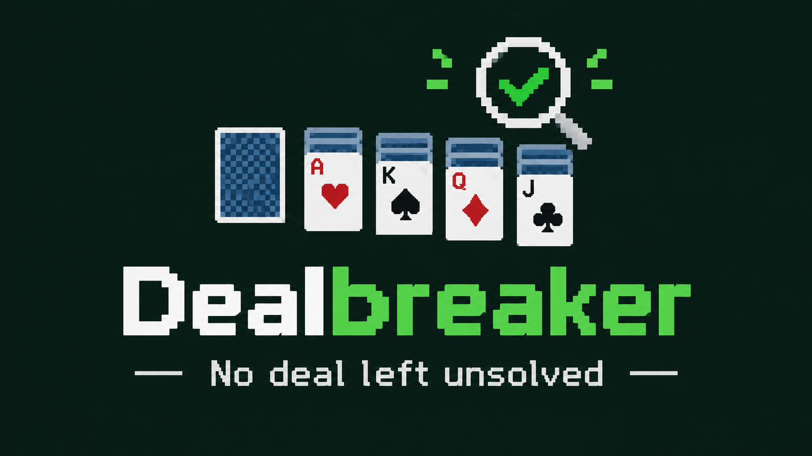
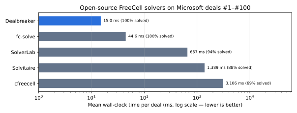

<p align="center">
  
</p>

# Dealbreaker

A fast patience (solitaire) solver written in Rust, where **every game is data**.

Instead of hard-coding rules into a search engine, Dealbreaker models solitaire games as small JSON files and solves them all with the same engine. Give it a deal and it will find a winning line, prove no win exists, suggest a fair hint, or find the highest score in points games.

## Highlights

* **39 built-in games** — Klondike, FreeCell, Spider, Yukon, TriPeaks, Poker Squares, and [33 more](docs/reference/presets.md).
* **Custom games in JSON** — describe new variants without touching Rust; see the [custom game tutorial](docs/tutorials/custom-game.md) and [rules schema](docs/reference/rules-schema.md).
* **Use it anywhere** — ships as a CLI, a Rust crate, Python wheels, a C ABI, and a ~600 KB dependency-free WebAssembly module ([docs](https://samdobson.github.io/dealbreaker/) · [live web demo](https://samdobson.github.io/dealbreaker/demo/)).
* **Fast** — solves 31,980 of the 32,000 Microsoft FreeCell deals in 13.1 ms mean time (proving #11982 unsolvable in 0.26 s).

## Benchmarks

Open-source FreeCell solvers on Microsoft deals `#1..#100` (single-threaded, 10 s timeout per deal):



Across all **32,000 Microsoft FreeCell deals** (`--max-states 500000`), Dealbreaker solves **31,980** (99.94%) and proves `#11982` unsolvable in **0.26 s** at **13.1 ms** mean time per deal. See [benchmarks](docs/explanation/benchmarks.md) for methodology.

## Quick start

Download a pre-built binary for macOS, Linux, or Windows from [GitHub Releases](https://github.com/samdobson/dealbreaker/releases), or install from [crates.io](https://crates.io/crates/dealbreaker-cli):

```sh
cargo install dealbreaker-cli
```

Solve a deal:

```
$ dealbreaker solve freecell --ms 1
   ...
   1. tableau 4 -> cell 1
   2. tableau 4 -> foundation 1
   ...
solved in 112 steps (1330 states, 0.003s)
```

Try a few more commands:

```sh
dealbreaker list                         # list all 39 presets
dealbreaker solve klondike --seed 42     # solve a seeded Klondike deal
dealbreaker hint klondike --seed 2       # get a hint without peeking at face-down cards
dealbreaker best poker-squares --seed 1  # maximize score in a points game
```

## Use it from Rust

```rust
use dealbreaker::{presets, solve, Game, Outcome, SolveOptions};

let game = Game::new(presets::klondike1())?;
let deal = game.deal(42);
let result = solve(&game, &deal, &SolveOptions::default());

if let Outcome::Solved(moves) = result.outcome {
    for step in game.steps(&deal, &moves) {
        println!("{step}");
    }
}
```

## Use it from JavaScript / TypeScript

Install from npm:

```sh
npm install dealbreaker
```

```ts
import { init, Solver } from "dealbreaker";

await init(); // optional in Node.js
const solver = Solver.fromPreset("klondike");
const deal = solver.deal(42);
const result = solver.solve(deal, { max_states: 500_000 });
```

Works in browsers, bundlers, Node.js, and Web Workers (`dealbreaker/worker`). See the [JavaScript/TypeScript reference](docs/reference/javascript.md) and [web app hints tutorial](docs/tutorials/web-app-hints.md).

## Documentation

Read the full documentation at **[samdobson.github.io/dealbreaker](https://samdobson.github.io/dealbreaker/)**:

* **Tutorials:** [Your first solve](docs/tutorials/first-solve.md) · [Build a custom game](docs/tutorials/custom-game.md) · [Add fair hints to a web app](docs/tutorials/web-app-hints.md)
* **How-to Guides:** [CLI & scripting](docs/how-to/cli-and-scripting.md) · [Fair hints](docs/how-to/fair-hints.md) · [Points games](docs/how-to/points-games.md) · [Search tuning](docs/how-to/tune-search.md) · [C/Swift/Kotlin FFI](docs/how-to/mobile-and-native.md)
* **Reference (auto-generated):** [39 built-in presets](docs/reference/presets.md) · [Rules JSON schema](docs/reference/rules-schema.md) · [CLI](docs/reference/cli.md) · [JS/TS](docs/reference/javascript.md) · [Python](docs/reference/python.md) · [C ABI](docs/reference/c-abi.md)
* **Explanation:** [Verdicts & soundness](docs/explanation/verdicts-and-soundness.md) · [Hidden cards](docs/explanation/hidden-cards.md) · [Engine & search](docs/explanation/engine-and-search.md) · [Benchmarks](docs/explanation/benchmarks.md) · [Architecture (`DESIGN.md`)](DESIGN.md) · [Changelog](CHANGELOG.md)

## Licence

Dual-licensed under [MIT](LICENSE-MIT) or [Apache-2.0](LICENSE-APACHE), at your option.
