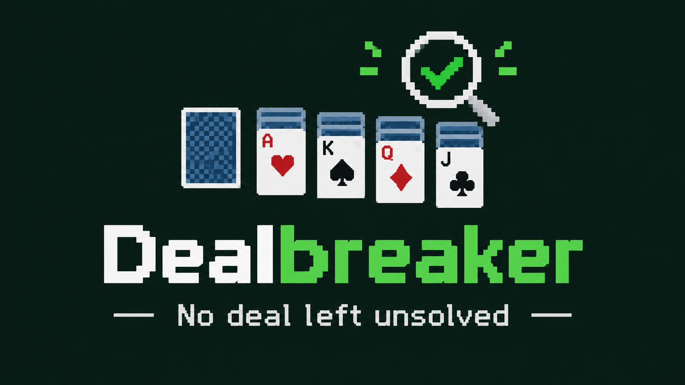

<p align="center">
  
</p>

<p align="center">
  <strong>A fast patience (solitaire) solver written in Rust, where every game is data.</strong>
</p>

Dealbreaker models solitaire variants as small JSON files and solves them with a single Rust engine — finding winning lines, proving unsolvability, suggesting fair hints, and maximising scores in points games. All search calls release the Python GIL.

- **39 built-in games** — Klondike, FreeCell, Spider, Yukon, TriPeaks, Poker Squares, and [more](https://samdobson.github.io/dealbreaker/reference/presets), plus custom games in JSON.
- **Fast** — solves 31,980 of 32,000 Microsoft FreeCell deals in 13.1 ms mean time, proving `#11982` unsolvable in 0.26 s.

## Quick start

```sh
pip install dealbreaker
```

```python
from dealbreaker import Solver

solver = Solver.from_preset("freecell")
result = solver.solve(solver.deal_microsoft(1))
print(result["outcome"], len(result["steps"]), "steps")
```

See the **[Python API reference](https://samdobson.github.io/dealbreaker/reference/python)** and **[documentation](https://samdobson.github.io/dealbreaker/)** for `best()`, `hint()`, `validate()`, `legal_steps()`, `play_step()`, and custom JSON rules.

## License

Dual-licensed under [MIT](https://github.com/samdobson/dealbreaker/blob/main/LICENSE-MIT) or [Apache-2.0](https://github.com/samdobson/dealbreaker/blob/main/LICENSE-APACHE), at your option.
