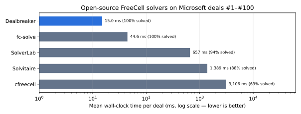

# Benchmarks

Dealbreaker is 3× faster than fc-solve, 44× faster than SolverLab, 93× faster than Solvitaire and 207× faster than cfreecell.

All benchmarks were run single-threaded on an Apple-silicon laptop using release builds.

## Open-Source FreeCell Solvers (Microsoft Deals #1–#100)

Each solver was given the exact same 100 Microsoft FreeCell deals (`#1..#100`) with a 10-second timeout per deal.

* **Fastest mean time & 100% solve rate:** Dealbreaker solves all 100 deals in **15.0 ms** mean per deal (including CLI startup; **7.4 ms** in-process across all 32,000 deals).
* **Outperforms both general and dedicated solvers:** **3.0× faster** mean time than `fc-solve` (default), **44× faster** than `SolverLab`, **93× faster** than `Solvitaire`, and **207× faster** than `cfreecell`.

### Methodology & Versions

* **Dealbreaker:** `cargo build --release` (default options), timed per CLI invocation.
* **fc-solve:** built from `shlomif/fc-solve` `master` with AppleClang `-O3` (default settings), timed per CLI invocation.
* **SolverLab:** built from `jsgrrchg/SolverLab` `main` (`solver-core-rs` in release mode), timed in-process via `FreeCellSolver::solve(&board, 10.0, false)`.
* **Solvitaire:** built from `thecharlieblake/Solvitaire` commit `2398305` with AppleClang `-O3` (`--type free-cell`), timed per CLI invocation.
* **cfreecell:** built from `Julien00859/cfreecell` `master` with AppleClang `-O3 -std=c99`, timed per CLI invocation.

## Microsoft FreeCell (32,000 Deals)

On the full 32,000 Microsoft FreeCell deals (`dealbreaker bench freecell --microsoft --seeds 1..32000 --max-states 500000 --jobs 1`, 3 min 58 s total):

* **31,996** solved (99.99%)
* **1** proven unsolvable (`#11982`)
* **3** gave up within the 500k-state budget (every other deal is known to be solvable)
* **108** moves mean solution length
* **7.4 ms** mean time per deal
